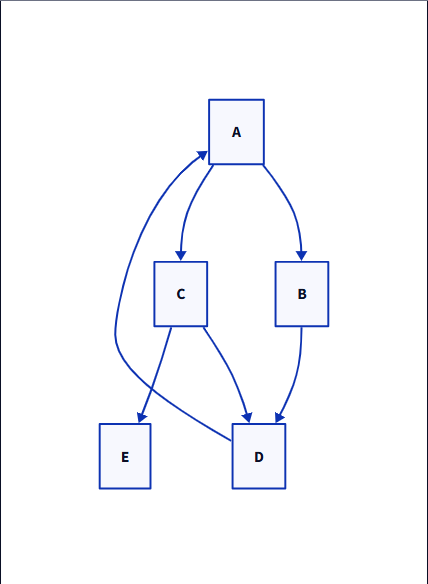
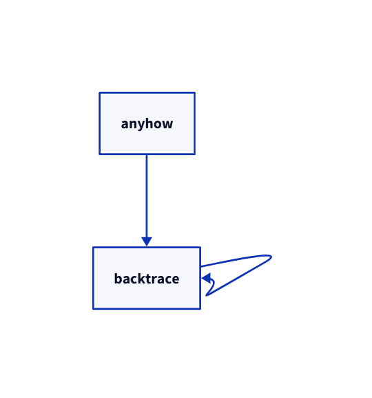
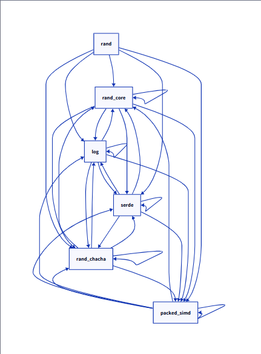

## Проверка работы (Этап 1)

Для проверки работоспособности приложения и 
демонстрации обработки ошибок выполните следующие шаги.

### 1. Успешный запуск (Вывод параметров)
Убедитесь, что в файле `configs/config_real.yaml` указаны корректные данные, 
и запустите программу:
```bash
python main.py configs/config.yaml
```

Ожидаемый вывод: 
```
--- Текущая конфигурация ---
package_name: requests
repository_url: https://github.com/psf/requests
test_repo_mode: true
package_version: 2.31.0
filter_substring: req
----------------------------

Успешно! Конфигурация загружена.
```

### 2. Демонстрация обработки ошибок

Приложение перехватывает ошибки и выводит понятные сообщения 
на русском языке вместо стандартных стектрейсов Python. 
Для проверки внесите изменения в config.yaml и запустите программу заново.

#### А) Ошибка: Файл не найден (FileNotFound)

Действие: Запустите программу с несуществующим путем: 
```
python main.py configs/wrong_file.yaml
```

Ожидаемый вывод: 
```
ОШИБКА: Файл конфигурации 'configs/wrong_file.yaml' не найден.
```

#### Б) Ошибка: Синтаксис YAML (YAMLError)

Действие: Действие: Откройте config.yaml и 
удалите закрывающую скобку( "package_name: [requests " ).
Запустите программу: 
```
python main.py configs/config.yaml
```

Ожидаемый вывод: 
```
ОШИБКА: Некорректный синтаксис YAML файла.
Детали: while parsing a flow sequence
  in "configs/config.yaml", line 1, column 15
expected ',' or ']', but got '<stream end>'
  in "configs/config.yaml", line 1, column 24
```

#### В) Ошибка: Отсутствует обязательный параметр (Pydantic)

Действие: В config.yaml переименуйте package_name в package_nam. 
Запустите программу: 
```
python main.py configs/config.yaml
```

Ожидаемый вывод: 
```
ОШИБКА: Некорректные значения параметров в конфигурации:
  - Параметр 'package_name': Field required
```

#### Г) Ошибка: Неверный тип данных (Pydantic)

Действие: Измените логическое значение на список( "test_repo_mode: [1, 2]" ). 
Запустите программу: 
```
python main.py configs/config.yaml
```

Ожидаемый вывод: 
```
ОШИБКА: Некорректные значения параметров в конфигурации:
  - Параметр 'test_repo_mode': Input should be a valid boolean
```

#### Д) Ошибка: Кастомная валидация URL

Действие: Укажите URL без протокола http:// или 
https://( "repository_url: "github.com/psf/requests"" ). Запустите программу: 
```
python main.py configs/config.yaml
```

Ожидаемый вывод: 
```
ОШИБКА: Некорректные значения параметров в конфигурации:
  - Параметр 'repository_url': Value error, URL должен начинаться с http://, 
  https:// или быть локальным путем
```

## Проверка работы (Этап 2)

### 1. Успешный запуск (Вывод параметров)

```
python main.py configs/config.yaml
```

Ожидаемый вывод:

```
--- Текущая конфигурация ---                                                                                                                                                  
package_name: anyhow                                                                                                                                                          
repository_url: https://github.com/dtolnay/anyhow                                                                                                                             
package_version: 1.0.75                                                                                                                                                       
----------------------------

Сбор данных о зависимостях для пакета 'anyhow' (версия: 1.0.75)...

--- Прямые зависимости (1 шт.) ---
- backtrace: {'version': '0.3.51', 'optional': True}
-----------------------------------------

Этап 2 успешно завершен.
```

### 2. Демонстрация обработки ошибок

Действие: Укажите в конфиге package_version: "999.999.999". Запустите программу:

```
python main.py configs/config.yaml
```

Ожидаемый вывод:

```
--- Текущая конфигурация ---                                                                          
package_name: anyhow                                                                                   
repository_url: https://github.com/dtolnay/anyhow   
package_version: 999.999.999                                                               
----------------------------

Сбор данных о зависимостях для пакета 'anyhow' (версия: 999.999.999)...

ОШИБКА СБОРА ДАННЫХ:
Не удалось найти файл Cargo.toml в репозитории.
Проверены URL: ['https://raw.githubusercontent.com/dtolnay/anyhow/v999.999. ...]
Убедитесь, что URL и версия (тег) указаны верно.
```

## Проверка работы (Этап 3)

### 1. Успешный запуск (Вывод параметров)

Запуск тестового режима:

```
python main.py configs/config_test.yaml
```

Ожидаемый вывод:

```
--- Текущая конфигурация ---                               
package_name: A                                                               
test_repo_mode: True
filter_substring: SER                                                         
----------------------------
                                                           
Построение графа зависимостей для 'A'...
  [!] Обнаружен цикл: A -> B -> D -> A

--- Граф зависимостей ---
A -> B, C
B -> D
D -> A
C -> D, E
E -> (нет зависимостей)
-------------------------

Этап 3 успешно завершен.
```

Запуск реального режима:

```
python main.py configs/config_real.yaml
```

Ожидаемый вывод:

```
--- Текущая конфигурация ---
package_name: anyhow
test_repo_mode: False
filter_substring: 
----------------------------

Построение графа зависимостей для 'anyhow'...
  [!] Обнаружен цикл: backtrace -> backtrace

--- Граф зависимостей ---
anyhow -> backtrace
backtrace -> backtrace
-------------------------

Этап 3 успешно завершен.
```

## 🔄 Проверка работы (Этап 4) 

### Порядок загрузки зависимостей

Программа поддерживает вывод порядка загрузки пакетов 
(топологическая сортировка на основе пост-ордера DFS). 

**Объяснение расхождений с Cargo:**
Порядок загрузки не является уникальным. Если пакет зависит от нескольких 
других, порядок их загрузки может варьироваться. Наш алгоритм использует 
обход в глубину, загружая сначала самую глубокую ветку зависимостей. 
Менеджер пакетов `cargo` может использовать иной порядок 
(например, параллельный или основанный на алфавитном порядке), 
однако оба подхода гарантируют, что зависимость всегда загружается 
раньше пакета, который её требует.

## 🎨 Проверка работы (Этап 5)

### Визуализация (D2)

Программа генерирует текстовое описание графа на языке **D2**. 
Чтобы увидеть картинку, скопируйте вывод программы и вставьте его в 
[D2 Playground](https://play.d2lang.com/).

### Сравнение с `cargo tree` (менеджер пакетов Rust)
При сравнении нашего вывода с результатом команды `cargo tree` 
можно заметить следующие расхождения:

1. **Формат представления (Дерево vs Граф):** 
   `cargo tree` выводит иерархическое дерево. Если один пакет (например, `serde`) 
2. используется разными ветками зависимостей, `cargo` либо дублирует его, 
   либо помечает звездочкой `(*)`, чтобы не выводить ветку повторно.
   Наш инструмент и язык D2 строят **направленный граф**. 
   Общие зависимости рисуются один раз, а к ним просто подводится несколько 
  стрелок от разных пакетов. Это делает диаграмму более компактной и наглядной.
   
2. **Обработка циклов:** 
   В `Cargo` циклические зависимости запрещены на уровне компилятора 
   (сборка просто упадет с ошибкой). Наш инструмент (согласно Этапу 3) 
   умеет обрабатывать циклы в тестовом режиме, и D2 корректно отрисует их 
   в виде замкнутого кольца.
   
3. **Фильтрация:** 
   В `cargo tree` можно исключить dev-зависимости, но нельзя отфильтровать 
   пакеты по подстроке. Наш инструмент удаляет ненужные узлы до того, как они
   попадут в D2-код, что делает итоговую схему чище.


Ожидаемый вывод для `python src/main.py configs/config_test.yaml`:

```
Анализ пакета: A
Режим тестирования: True
  [!] Обнаружен цикл: A -> B -> D -> A

--- Граф зависимостей ---
A -> B, C
B -> D
D -> A
C -> D, E
E -> (нет зависимостей)
-------------------------

--- Порядок загрузки (от листьев к корню) ---
1. A
2. C
3. E
4. B
5. D
----------------------------------------------

--- Диаграмма D2 ---
# Код диаграммы D2

"A" -> "B"
"A" -> "C"
"B" -> "D"
"D" -> "A"
"C" -> "D"
"C" -> "E"
"E"
--------------------
```

Форматирование D2-кода:


Ожидаемый вывод для `python src/main.py configs/config_anyhow.yaml`:

```
Анализ пакета: anyhow
Режим тестирования: False
  [!] Обнаружен цикл: backtrace -> backtrace

--- Граф зависимостей ---
anyhow -> backtrace
backtrace -> backtrace
-------------------------

--- Порядок загрузки (от листьев к корню) ---
1. anyhow
2. backtrace
----------------------------------------------

--- Диаграмма D2 ---
# Код диаграммы D2

"anyhow" -> "backtrace"
"backtrace" -> "backtrace"
--------------------
```

Форматирование D2-кода:


Ожидаемый вывод для `python src/main.py configs/config_rand.yaml`:

```
Анализ пакета: rand
Режим тестирования: False
  [!] Обнаружен цикл: rand_core -> rand_core
  [!] Обнаружен цикл: rand_core -> log -> rand_core
  [!] Обнаружен цикл: log -> log
  [!] Обнаружен цикл: rand_core -> log -> serde -> rand_core
  [!] Обнаружен цикл: log -> serde -> log
  [!] Обнаружен цикл: serde -> serde
  [!] Обнаружен цикл: rand_core -> log -> serde -> rand_chacha -> rand_core
  [!] Обнаружен цикл: log -> serde -> rand_chacha -> log
  [!] Обнаружен цикл: serde -> rand_chacha -> serde
  [!] Обнаружен цикл: rand_chacha -> rand_chacha
  [!] Обнаружен цикл: rand_core -> log -> serde -> rand_chacha -> packed_simd -> rand_core
  [!] Обнаружен цикл: log -> serde -> rand_chacha -> packed_simd -> log
  [!] Обнаружен цикл: serde -> rand_chacha -> packed_simd -> serde
  [!] Обнаружен цикл: rand_chacha -> packed_simd -> rand_chacha
  [!] Обнаружен цикл: packed_simd -> packed_simd

--- Граф зависимостей ---
rand -> rand_core, log, serde, rand_chacha, packed_simd
rand_core -> rand_core, log, serde, rand_chacha, packed_simd
log -> rand_core, log, serde, rand_chacha, packed_simd
serde -> rand_core, log, serde, rand_chacha, packed_simd
rand_chacha -> rand_core, log, serde, rand_chacha, packed_simd
packed_simd -> rand_core, log, serde, rand_chacha, packed_simd
-------------------------

--- Порядок загрузки (от листьев к корню) ---
1. rand
2. rand_core
3. log
4. serde
5. rand_chacha
6. packed_simd
----------------------------------------------

--- Диаграмма D2 ---
# Код диаграммы D2

"rand" -> "rand_core"
"rand" -> "log"
"rand" -> "serde"
"rand" -> "rand_chacha"
"rand" -> "packed_simd"
"rand_core" -> "rand_core"
"rand_core" -> "log"
"rand_core" -> "serde"
"rand_core" -> "rand_chacha"
"rand_core" -> "packed_simd"
"log" -> "rand_core"
"log" -> "log"
"log" -> "serde"
"log" -> "rand_chacha"
"log" -> "packed_simd"
"serde" -> "rand_core"
"serde" -> "log"
"serde" -> "serde"
"serde" -> "rand_chacha"
"serde" -> "packed_simd"
"rand_chacha" -> "rand_core"
"rand_chacha" -> "log"
"rand_chacha" -> "serde"
"rand_chacha" -> "rand_chacha"
"rand_chacha" -> "packed_simd"
"packed_simd" -> "rand_core"
"packed_simd" -> "log"
"packed_simd" -> "serde"
"packed_simd" -> "rand_chacha"
"packed_simd" -> "packed_simd"
```

Форматирование D2-кода:
